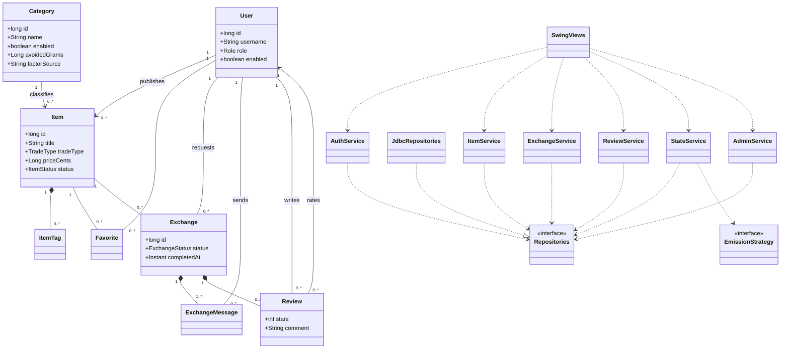
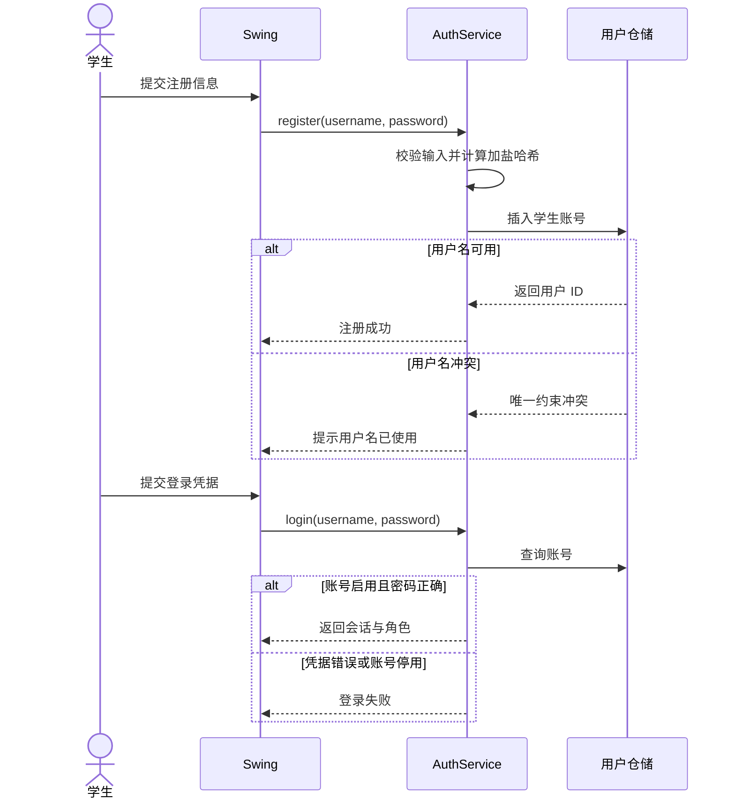
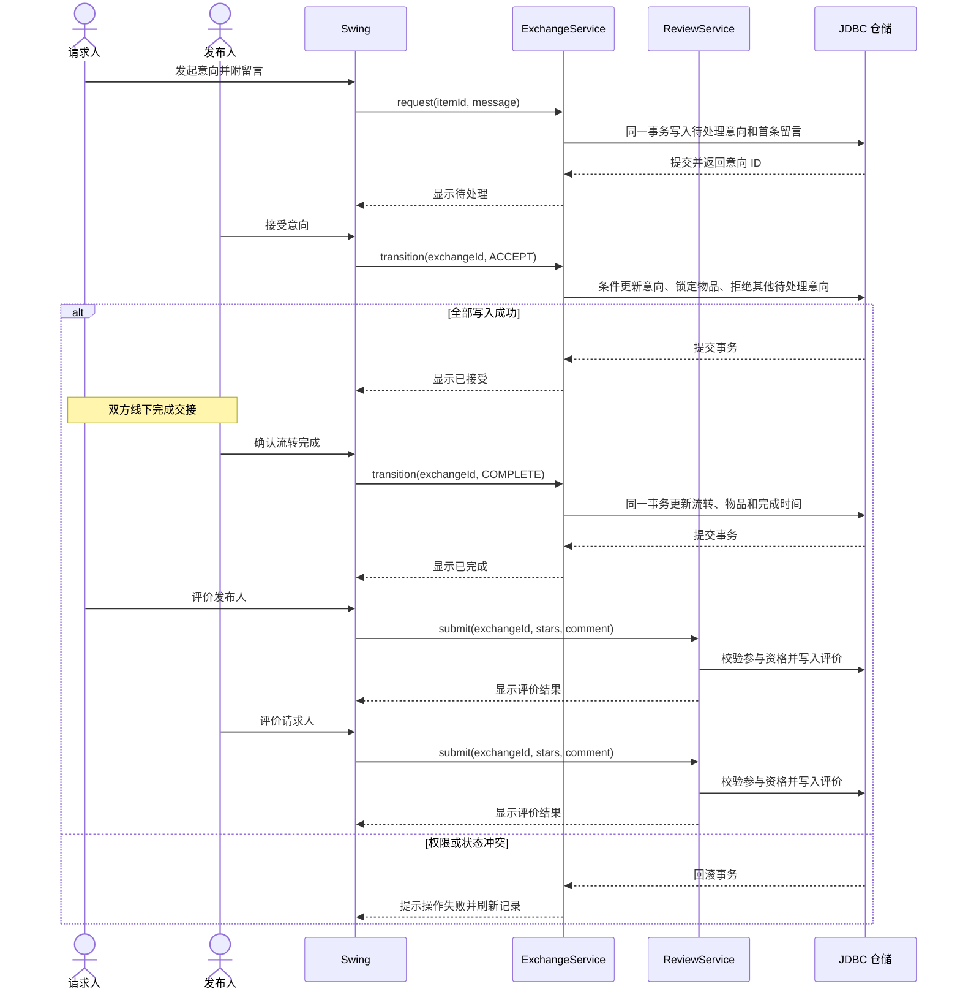
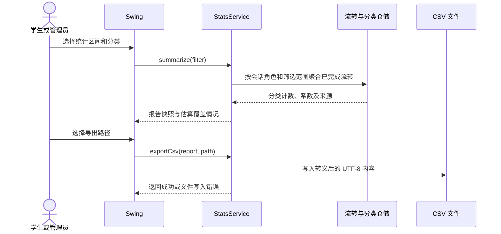

# 第一周 UML 设计

以下图描述第一周设计方案。业务规则和异常分支以[需求规格](requirements.md)及[接口与事务约定](architecture.md)为准。

## 领域类与模块关系

图中的 `Repositories` 代表按聚合拆分的仓储接口，`JdbcRepositories` 代表对应实现。

## 注册和登录

## 意向到互评

## 统计和导出

